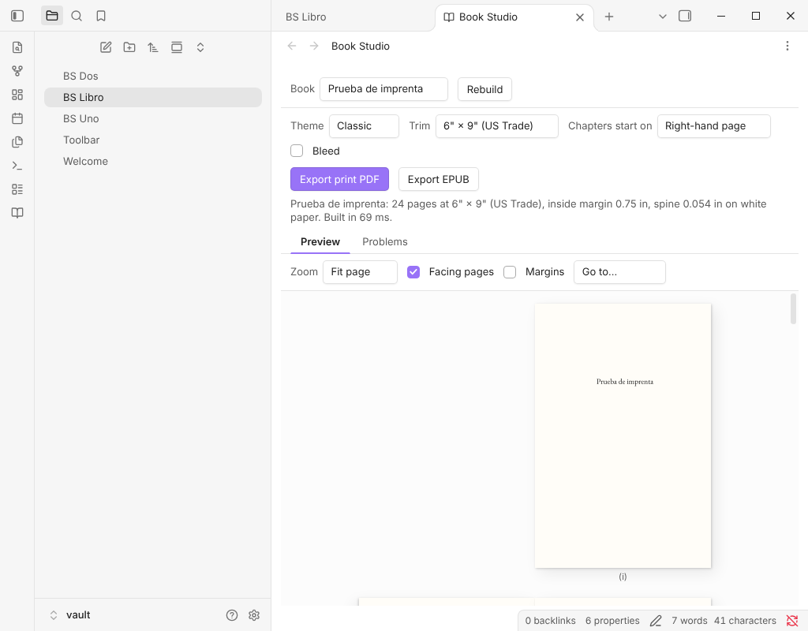

# Book Studio

Turn a folder of Markdown notes into a **print-ready paperback PDF** for Amazon KDP and an **EPUB 3** for every ebook store. Everything happens on your device: your manuscript is never uploaded anywhere.

No Pandoc, no LaTeX, nothing else to install, and it works on Obsidian mobile too.



**[Try it in your browser →](https://perezamadorluisenrique-gif.github.io/book-studio/)** The web app opens with a sample book, *The Wonderful Wizard of Oz*, already typeset.

Book Studio comes in two forms that share one engine and one interface:

- **An Obsidian plugin.** It works on the vault you write in, rebuilds the preview as you type and saves exports to a vault folder.
- **A web app.** Open a folder of Markdown files, such as your vault, in the browser, or write a book right there: it has a chapter editor, a book-details form, a cover image, and a **Publish checklist** of what KDP still needs. You can also import a Word (`.docx`), Markdown or text manuscript. Books you write in the web app are kept in your browser only. Nothing is uploaded.

Book Studio is free: unlimited books, every KDP trim size, the Classic, Modern, Elegant, Non-fiction and Large Print themes, footnotes at the page foot, the full wraparound cover, the KDP preflight and details sheet, the print PDF and EPUB 3. **Book Studio Pro** (a one-time license key) adds the genre themes (Thriller, Romance, Fantasy), a back-of-book index, one-click editions, box sets and the accessible-EPUB pack. See [Book Studio Pro](#book-studio-pro).

## Features

- **One note is the book.** A manifest note lists the chapters as links, in order, under *Front matter*, *Chapters* and *Back matter*. Its properties hold the title, author, theme and trim. To reorder chapters, reorder the links.
- **Real typesetting.** Knuth–Plass line breaking, hyphenation in the book's language, smart quotes and dashes, old-style figures and small caps where the theme calls for them. Widows and orphans are avoided.
- **Themes with character.** Drop caps, ornamental scene breaks, chapter openers, part pages and running heads. Themes: Classic, Modern, Elegant, Non-fiction and Large Print, plus the genre themes Thriller, Romance and Fantasy in Pro.
- **Ready for KDP.**
  - The 6" × 9" trim, the most common paperback size.
  - Inside margins that grow with the page count, as KDP requires.
  - Optional bleed, embedded fonts, chapters that open on a right-hand page, and padding to KDP's 24-page minimum.
  - The spine width is reported for your cover designer.
- **Front and back matter, built for you.** Half title, title page, copyright page (with ISBNs, edition and publisher), dedication, epigraph and table of contents, plus "Also by" and any notes you list.
- **Live paged preview.** Each page appears exactly as it will print. Zoom to fit the page or the width, and check facing pages side by side.
- **EPUB 3 for every store.** Semantic XHTML, a navigable table of contents and landmarks, embedded fonts, the cover, and the book's language on every page. Exports pass [EPUBCheck](https://www.w3.org/publishing/epubcheck/) with no messages.
- **Problems tab.** Broken links, missing images and chapters that can't be found are listed with the note and line they come from; in Obsidian, a click opens it.

## Writing a book

Create a note with `book: true` in its properties. That note is the manifest:

```markdown
---
book: true
title: The Lighthouse Keeper
subtitle: A Novel
author: Jane Doe
language: en
publisher: Harbor Press
isbn: 978-1-23456-789-7
ebook-isbn: 978-1-23456-790-3
copyright: "© 2026 Jane Doe. All rights reserved."
dedication: For my mother.
cover: images/cover.jpg
theme: classic
trim: 6x9
---

## Front matter
- [[Foreword]]

## Chapters
### Part One: The Sea
1. [[The Storm]]
2. [[Landfall|The Shore]]
3. ~~[[Cut Scene]]~~
### Part Two: The Light
4. [[The Keeper]]
5. [[Interlude]] unnumbered

%% Ideas for later:
- [[Sequel hook]]
%%

## Back matter
- [[Acknowledgments]]
- [[About the Author]]
```

- **Sections.** Links under *Front matter*, *Chapters* and *Back matter* go to those parts of the book. Section names in other languages work too ("Capítulos", "Kapitel", "Chapitres").
- **Parts.** A subheading inside *Chapters* starts a part, which gets its own part page.
- **Titles.** A chapter's title comes from the link alias (`[[Landfall|The Shore]]`), then the note's `title` property, then the file name. Leading numbers in file names, such as "01 The Cyclone", are dropped.
- **Drafts and comments.** A ~~struck-out~~ link is left out of the build. Anything inside `%% … %%` is ignored.
- **Unnumbered chapters.** Write `unnumbered` after a link, or set `numbered: false` in the chapter note. Front and back matter are never numbered.
- **Starting from a folder.** In Obsidian, *Create book from current folder* writes a manifest that lists the folder's notes.

Chapter notes are ordinary Markdown:
- **Scene breaks.** `* * *`, `***`, `---` or `# # #` on a line of its own become the theme's ornament.
- **Images.** `![[map.png|A hand-drawn map of the island]]` uses the alias as the image description. Write `decorative` as the alias for an image that carries no meaning.
- **Footnotes, block quotes, lists, tables and poetry** are all supported. For poetry, keep the line breaks.

### Manifest properties

| Property | Meaning |
| --- | --- |
| `title`, `subtitle`, `author` (or `authors`) | Title page, metadata and running heads |
| `language` | Hyphenation, quote style and EPUB language, for example `en`, `es`, `de`, `fr` |
| `publisher`, `year`, `edition`, `copyright` | Copyright page |
| `isbn`, `ebook-isbn` | Print ISBN on the copyright page; ebook ISBN as the EPUB identifier |
| `description`, `subjects` | Store description and subjects in the EPUB metadata |
| `series`, `series-number`, `also-by` | Series metadata and the "Also by" page |
| `dedication`, `epigraph`, `epigraph-source` | Their own pages in the front matter |
| `cover` | Cover image for the EPUB |
| `theme` | `classic`, `modern`, `elegant`, `nonfiction` or `large-print`; the genre themes `thriller`, `romance` and `fantasy` need Pro |
| `trim` | Any of the twelve KDP trims, for example `6x9`, `5x8` or `5.5x8.5` |
| `paper` | `white`, `cream` or `color`: sets the spine width |
| `footnotes` | `end` (default) or `page` for notes at the foot of the page |
| `index-terms` | A list of words and phrases for the back-of-book index (Pro) |
| `editions` | A block of editions, each with its own settings, ISBN and `format: print` or `epub` (Pro) |
| `back-blurb`, `author-bio`, `author-photo`, `tagline` | Back cover text, author photo and the cover's tagline |
| `cover-background`, `cover-ink`, `spine-title` | Cover colours and the spine text |
| `bleed` | `true` when images run off the page edge |
| `chapter-start` | `recto` (right-hand pages, the default) or `any` |
| `running-heads` | `author-title`, `title-chapter` or `none` |
| `toc`, `half-title`, `hyphenate`, `smart-quotes` | Turn those features on or off |
| `font-size` | Body size in points, from 7 to 24 |
| `scene-break` | Glyph to use for scene breaks, such as `❦` |

The studio's toolbar can override the theme and trim for a single export without editing the note.

**Hyphenation.** Words are split by language patterns (Spanish, Catalan, Galician, Basque, English, French, German, Italian, Portuguese and Dutch), never in capitalised acronyms or in words with digits, and a name in the middle of a sentence is split less willingly. To say where a word may split, put a soft hyphen (U+00AD) there: the word then splits only at those points. To keep a word whole, put a word joiner (U+2060) anywhere inside it. Neither character is printed.

## Importing a manuscript (web app)

In **My books**, choose *Import a manuscript* and pick a Word (`.docx`), `.md` or `.txt` file, or paste the text. It becomes a new book; every `# Heading`, "Chapter 3" or "Capítulo 3" line starts a chapter. From Word it keeps headings, bold and italic, lists, quotes, footnotes, links, page breaks and PNG or JPG pictures with their alt text. It leaves out tables, text boxes, equations, comments and the table of contents, and a report lists what was left out. Old `.doc` files are not read: save them as `.docx` first.

## Book Studio Pro

Pro is a one-time payment. You get a license key in the purchase email or receipt and paste it into the plugin's settings (or the web app's license panel), then press Activate. Without a key everything above keeps working, and the print PDF of a Pro theme is exported with a SAMPLE watermark so you can see the result first.

Pro adds:

- **Genre themes**: Thriller, Romance and Fantasy, and the ones to come.
- A **back-of-book index** built from `index-terms`.
- **Editions**: describe a paperback, a large-print edition and an ebook in the manifest and export them together, each with its own ISBN, cover and report.
- **Box sets** and the **accessible EPUB pack**.

Free, and never Pro again: every trim size, the Elegant, Non-fiction and Large Print themes, footnotes at the page foot, the **full cover** (front, spine and back with barcode space, at the size KDP expects), the **KDP preflight** (page count, margins, images, blank runs, ISBN, metadata, spine and the PDF itself, with an HTML report; it reduces rejections, and KDP's own review makes the final decision) and the **KDP details sheet** (title, description, keywords and categories ready to paste).

Keys are generated by the payment service. Offline Ed25519 signed keys (`tools/license.mjs`: `keygen`, `sign`, `verify`; public key in `src/engine/license-keys.ts`) are also accepted for sales made by hand; they need no network at all.

## Payment and network use

- Pro is a **one-time payment**: no subscription, and the key never expires.
- **Free forever**, as in `src/engine/entitlements.ts`: any number of books, every KDP trim, the Classic, Modern, Elegant, Non-fiction and Large Print themes, footnotes at the page foot, the full cover, the KDP preflight and details sheet, the print PDF, EPUB 3 with its basic accessibility metadata, and the preview of everything. Nothing an earlier version let you do is ever taken away.
- **Activate sends your key once** to the licence endpoint of the payment service the key came from (Polar, Lemon Squeezy or Gumroad), to check that it is valid for Book Studio Pro. The result is stored on your device and the key is never checked again, so being offline later never locks you out.
- **Nothing else ever goes over the network**: no telemetry, no analytics, no account, and your notes and books never leave your device.
- Author: Siulved54.

## Privacy

- **Your notes, images and exports never leave your device.** Parsing, typesetting and PDF and EPUB generation all run locally.
- **The only network request is Activate** (see "Payment and network use" above). The web app otherwise loads only its own files (the sample book and fonts) from the site it is served from. There is no account, no telemetry, no analytics and no ads.
- The plugin keeps its settings in its `data.json` in your vault. The web app keeps them in your browser's local storage.

## Free template

[`templates/starter-book`](templates/) is a small ready-to-write book that uses only free features. Copy it into your vault and open the studio. For numbered reports, see the free template in [Section Numbering](https://github.com/perezamadorluisenrique-gif/section-numbering/tree/main/templates).

## Installing

### Obsidian

Search for **Book Studio** under *Settings → Community plugins → Browse*. To install by hand instead:

1. Download `main.js`, `manifest.json` and `styles.css` from the [latest release](https://github.com/perezamadorluisenrique-gif/book-studio/releases/latest).
2. Copy `main.js`, `manifest.json` and `styles.css` into `<your vault>/.obsidian/plugins/book-studio/`.
3. Enable **Book Studio** under *Settings → Community plugins*.

Open the studio from the ribbon icon or the command palette. The commands are *Open studio*, *Export print PDF*, *Export EPUB* and *Create book from current folder*. Exports are saved to the folder chosen in settings, *Book Studio exports* by default. The plugin works on desktop and mobile and needs Obsidian 1.7.2 or later.

### Web app

Open [the web app](https://perezamadorluisenrique-gif.github.io/book-studio/) and choose **Open a folder** to load your own notes. To host it yourself, `npm run build:web` writes a static site to `dist/web/` that any static host can serve.

The site also has guides for KDP authors in [English](https://perezamadorluisenrique-gif.github.io/book-studio/en/) and [Spanish](https://perezamadorluisenrique-gif.github.io/book-studio/es/) (trim sizes and margins, accessible EPUB, Markdown to book, a comparison with other formatters) and two sample books to download as print PDF, EPUB and Markdown source: *The Wonderful Wizard of Oz* and Bécquer's *Leyendas y rimas* (`?sample=leyendas` opens it in the app).

## Development

```sh
npm install
npm run build          # plugin (main.js, styles.css)
npm run build:all      # plugin and web app
npm run build:web      # the web app, the sample downloads and the guide pages (dist/web/)
npm run downloads      # sample PDFs, EPUBs and source zips; fails if a PDF breaks a KDP rule
npm run epubcheck      # W3C EPUBCheck on the sample EPUBs (needs Java)
npm run dev            # unminified builds with source maps
npm run typecheck
npm run lint           # ESLint with Obsidian's plugin review rules
npm test               # Vitest: parsing, layout, EPUB, audit, KDP check, guide pages
npm run sample         # render the sample book to out/ from the command line
```

The guide pages are Markdown in `site/en/` and `site/es/`, built by `tools/site.mjs` (no JavaScript on the pages, no requests to other hosts). Their facts and sources are in `docs/web-launch/FACTS.md`.

`npm run sample` runs the same pipeline from Node, which helps when checking output. Its script, `tools/render-sample.ts`, is a development tool that reads and writes files with `node:fs` and `node:path`; it is not part of the plugin, which never touches the file system outside Obsidian's vault API:

```sh
npm run sample -- path/to/folder
npm run sample -- --theme modern --out out/oz-modern
```

### Layout

```
src/engine/    Parsing, typesetting, PDF, EPUB and checks (no DOM, no Obsidian)
src/app/       The studio UI shared by both hosts: toolbar, preview, export dialogs
src/preview/   Canvas renderer for the paged preview
src/obsidian/  Plugin entry: view, commands, settings, vault access
src/web/       Web app entry: folder picker, downloads, local storage
tests/         Vitest suites
tools/         Command-line renderer
sample/oz/     The sample book
fonts/         Bundled typefaces
```

## Credits and licenses

- Book Studio is released under the [MIT License](LICENSE).
- The bundled fonts are under the [SIL Open Font License 1.1](fonts/OFL.txt): EB Garamond, Crimson Pro, Cormorant Garamond, Montserrat, Atkinson Hyperlegible and Inconsolata.
- The text of *The Wonderful Wizard of Oz* (L. Frank Baum, 1900) is in the public domain. The sample's cover and illustration were made for this project and are under the MIT License.
- Libraries: [pdf-lib](https://pdf-lib.js.org), [fontkit](https://github.com/foliojs/fontkit), [JSZip](https://stuk.github.io/jszip/), [marked](https://marked.js.org), [yaml](https://eemeli.org/yaml/) and [hyphen](https://github.com/ytiurin/hyphen).

## More plugins by Siulved54

| Plugin | What it does | Source |
| --- | --- | --- |
| [Shared Blocks](https://obsidian.md/plugins?id=shared-blocks) | Write a block of text once and reuse it in any note. Edit the source and every reference re-renders live. | [shared-blocks](https://github.com/perezamadorluisenrique-gif/shared-blocks) |
| [Text Case and Cleanup](https://obsidian.md/plugins?id=text-format) | Change case, make camelCase or slugs, sort lines and remove duplicates, and repair text pasted out of a PDF, without touching code or URLs. | [text-format](https://github.com/perezamadorluisenrique-gif/text-format) |
| [Typography as You Type](https://obsidian.md/plugins?id=typography-as-you-type) | Curly quotes, dashes and ellipses as you type, kept out of code and maths, with Backspace to take one back. | [smart-typography-plugin](https://github.com/perezamadorluisenrique-gif/smart-typography-plugin) |
| [Section Numbering](https://obsidian.md/plugins?id=section-numbering) | Number headings as an outline (1, 1.1, 1.2) and keep every link to them working when they renumber. | [section-numbering](https://github.com/perezamadorluisenrique-gif/section-numbering) |
| [Spreadsheet to Table](https://obsidian.md/plugins?id=spreadsheet-to-table) | Paste cells from Excel or Google Sheets as a Markdown table with a real header, insert CSV files, and copy tables back out. | [spreadsheet-to-table](https://github.com/perezamadorluisenrique-gif/spreadsheet-to-table) |
| [Hybrid Line Numbers](https://obsidian.md/plugins?id=hybrid-line-numbers) | Relative and hybrid line numbers for Vim-style jumps, where a folded section counts as one line. | [hybrid-line-numbers](https://github.com/perezamadorluisenrique-gif/hybrid-line-numbers) |
| [List Item Callouts](https://obsidian.md/plugins?id=list-item-callouts) | Colour a single list item as a callout by starting it with a character such as `&`, `!` or `?`. | [list-item-callouts](https://github.com/perezamadorluisenrique-gif/list-item-callouts) |
| [Folder Counts](https://obsidian.md/plugins?id=folder-counts) | See how many notes or files each folder holds, right in the file explorer, with a vault total and folder exclusions. | [folder-counts](https://github.com/perezamadorluisenrique-gif/folder-counts) |
| [Note Reading Time](https://obsidian.md/plugins?id=note-reading-time) | Reading time of the current note or your selection in the status bar, optionally saved to a property. | [note-reading-time](https://github.com/perezamadorluisenrique-gif/note-reading-time) |
| [Task Rollover](https://obsidian.md/plugins?id=task-rollover) | Roll unfinished tasks from your last daily note into today's when it is created, with a real undo. | [task-rollover](https://github.com/perezamadorluisenrique-gif/task-rollover) |
| [Zoom Into Section](https://obsidian.md/plugins?id=zoom-into-section) | Zoom into a heading or list item to see only it and its contents, with a breadcrumb bar to climb back out. | [zoom-into-section](https://github.com/perezamadorluisenrique-gif/zoom-into-section) |
| [Link Title on Paste](https://obsidian.md/plugins?id=link-title-on-paste) | Paste a web address and get a Markdown link with the page's title, fetched in the background and undone in one step. | [link-title-on-paste](https://github.com/perezamadorluisenrique-gif/link-title-on-paste) |
| [Update Radar](https://obsidian.md/plugins?id=update-radar) | Checks your installed community plugins for updates in the background, shows what changed, and flags the ones that look abandoned. | [community-update-checker](https://github.com/perezamadorluisenrique-gif/community-update-checker) |
| [Dataview to Bases](https://obsidian.md/plugins?id=dataview-to-bases) | Convert Dataview queries into Bases blocks, and see which queries in your vault can be converted. | [dataview-to-bases](https://github.com/perezamadorluisenrique-gif/dataview-to-bases) |
| [Line Editing Commands](https://obsidian.md/plugins?id=line-editing-commands) | Duplicate, join, sort and reverse lines, insert blank lines and jump to a line number, with multi-cursor support. | [line-editing-commands](https://github.com/perezamadorluisenrique-gif/line-editing-commands) |
| [Note Mover Rules](https://obsidian.md/plugins?id=note-mover-rules) | Move notes into folders by ordered rules on tags, properties, titles and paths, with a preview before any bulk move. | [note-mover-rules](https://github.com/perezamadorluisenrique-gif/note-mover-rules) |
| [Tab History](https://obsidian.md/plugins?id=tab-history) | Keeps each tab's back and forward history across restarts, and adds commands to move, maximize and close tabs. | [tab-history](https://github.com/perezamadorluisenrique-gif/tab-history) |
| [URL Cards](https://obsidian.md/plugins?id=url-cards) | Shows web addresses as cards with title, description and image, and reads existing cardlink blocks. | [url-cards](https://github.com/perezamadorluisenrique-gif/url-cards) |
| [Vim Config](https://obsidian.md/plugins?id=vim-config) | Loads a vimrc-style file from your vault so your key mappings and editor commands are ready when vim mode starts. | [vim-config](https://github.com/perezamadorluisenrique-gif/vim-config) |
| [Task Archive](https://obsidian.md/plugins?id=task-archive) | Moves completed tasks, with their sub-items, into an archive section or note. | [task-archive](https://github.com/perezamadorluisenrique-gif/task-archive) |
| [Revisit Later](https://obsidian.md/plugins?id=revisit-later) | Link the current note into a future daily note, with a date typed in plain English, so it comes back when you want to review it. | [revisit-later](https://github.com/perezamadorluisenrique-gif/revisit-later) |
| [Explorer Colors Plus](https://obsidian.md/plugins?id=explorer-colors-plus) | Color files and folders in the file explorer, with a palette, cascading to children, and import from File Color. | [explorer-colors-plus](https://github.com/perezamadorluisenrique-gif/explorer-colors-plus) |
| [Book Lookup](https://obsidian.md/plugins?id=book-lookup) | Create book notes from Open Library or Google Books, with cover images, ISBN search and Book Search compatible templates. | [book-lookup](https://github.com/perezamadorluisenrique-gif/book-lookup) |
| [Web Search Menu](https://obsidian.md/plugins?id=web-search-menu) | Search the web for selected text or the note title from the right-click menu, with engines you define. | [web-search-menu](https://github.com/perezamadorluisenrique-gif/web-search-menu) |
| [Word Lookup](https://obsidian.md/plugins?id=word-lookup) | Look up any word in a sidebar dictionary with definitions, phonetics, synonyms and antonyms, or create a note for it. | [word-lookup](https://github.com/perezamadorluisenrique-gif/word-lookup) |
| [Quick Translate](https://obsidian.md/plugins?id=quick-translate) | Translate the selection or a whole note into another language with no account, keeping links, code and front matter untouched. | [quick-translate](https://github.com/perezamadorluisenrique-gif/quick-translate) |
| [Dice Rolls](https://obsidian.md/plugins?id=dice-rolls) | Inline dice rolls you click to reroll, in Live Preview and Reading view, with full dice notation, a roll dialog and a roll history. Reads Dice Roller notes. | [dice-rolls](https://github.com/perezamadorluisenrique-gif/dice-rolls) |
| [Claude Studio](https://obsidian.md/plugins?id=claude-studio) | Notion-style AI writing, chat and vault tools powered by your local Claude Code CLI. | [claude-studio](https://github.com/perezamadorluisenrique-gif/claude-studio) |
| [Emoji Search](https://obsidian.md/plugins?id=emoji-search) | Insert emojis from a searchable picker or by typing a :shortcode. | [emoji-search](https://github.com/perezamadorluisenrique-gif/emoji-search) |
| [Inline TOC](https://obsidian.md/plugins?id=inline-toc) | Show a live table of contents inside any note with a toc code block, or insert a plain Markdown one. | [inline-toc](https://github.com/perezamadorluisenrique-gif/inline-toc) |

All of them are in the community directory: Settings -> Community plugins ->
Browse, then search for the name. Demos and install links for every one:
[the catalog](https://perezamadorluisenrique-gif.github.io/catalog/).

Follow new plugins and updates on X: [@luenpereza](https://x.com/luenpereza)
